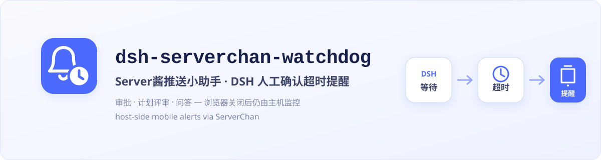
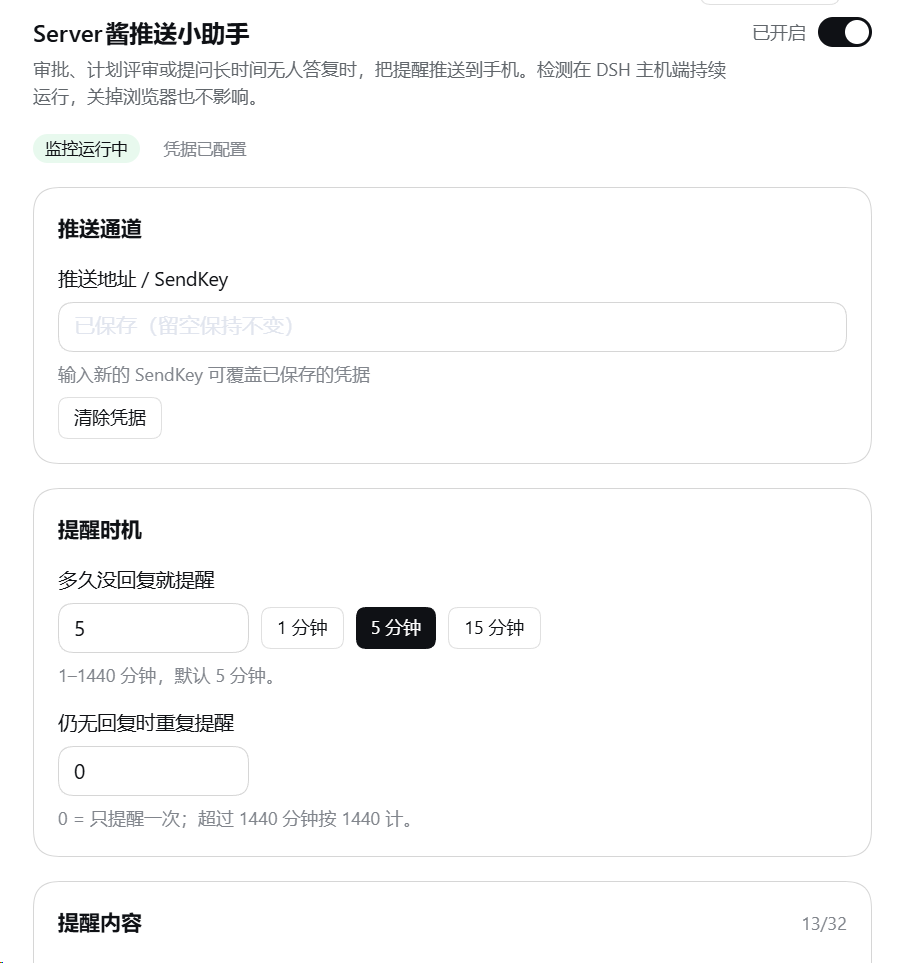

# dsh-serverchan-watchdog

[中文](./README.md) · **English**



[](https://github.com/MaRi23333/dsh-serverchan-watchdog/actions/workflows/ci.yml)
[](https://www.npmjs.com/package/dsh-serverchan-watchdog)


[](./LICENSE)


When an approval, plan review, or `ask_user_question` response remains pending past the configured threshold, this plugin sends a mobile alert through ServerChan from the DeepSeek Harness (DSH) host—even with the browser closed.

> `dsh-serverchan-watchdog` is an independently developed community plugin. It is not affiliated with, sponsored by, or endorsed by ServerChan or DeepSeek Harness; their names are used only to identify compatible services.

## What it solves

Browser notifications are useful while you are at the computer. This plugin keeps the timer on the host and reaches your phone after you leave the desk or close the tab. Both types of notification can be used together.

- **Host-side monitoring** over the durable session event stream; no browser connection required.
- **Three native interaction seams**: questions, plan reviews, and tool/sandbox approvals.
- **Restart recovery** from unclosed session-log pairs while preserving their original start time.
- **Bounded failure handling**: network errors, timeouts, and HTTP 5xx responses get at most two retries; HTTP 4xx (including 429), ServerChan business errors, and malformed responses stop immediately.
- **Encrypted local storage**: the SendKey is stored as AES-256-GCM ciphertext and never returned by the API or written to logs.

## Watched interactions

| Interaction | Starts at | Ends at |
| --- | --- | --- |
| `ask_user_question` | its `tool/call` | matching `tool/result` by `callId` |
| `exit_plan_mode` plan review | its `tool/call` | matching `tool/result` by `callId` |
| Tool or sandbox approval | `approval/asked` | matching `approval/decided` by ID |

The default threshold is five minutes and one successful alert per interaction. An optional repeat interval enables later reminders. A missing credential only defers the local check: it makes no network request and consumes no retry attempt.

## Screenshot

<p align="center">
  <br>
  <em>The top of the settings page shows the master switch and live status, with separate cards for credentials and reminder timing. A stored SendKey is never echoed. Further cards cover the message, jump link, network and pending queue.</em>
</p>

## Host and desktop compatibility

This update targets DSH `0.2.0-rc.2` and the desktop client of the same version. The development team reports it working after migration, and runtime versions and bundle admission requirements have been checked. The desktop settings UI, real background alerts and notification-client handling of `dsh://` still need validation in the actual environment; load compatibility is not end-to-end acceptance.

**0.2.2** updates the HTTP dependency Undici to `7.30.1`, including upstream security fixes, without changing reminder behavior or existing configuration. The earlier `0.2.1` update added Ignore / Restore alerts for stuck confirmations. Ignoring takes effect immediately, survives a restart, and affects only that item in its session; it does not approve or answer the original request. Existing settings drafts are neither saved nor discarded by these actions. See [CHANGELOG.md](./CHANGELOG.md) for the full update.

## Install

### Desktop client (recommended)

Desktop and Web have separate plugin installations and activation states; installing for Web does not enable the desktop plugin. The desktop GUI route needs no PATH setup.

1. In the desktop sidebar, open **Plugins** → **Add plugin**.
2. Enter the npm package name `dsh-serverchan-watchdog@latest` and install it.
3. Click **Enable now** when installation finishes. Closing the completed-install dialog leaves the plugin disabled.
4. Restart only if the UI asks you to: fully exit with **Quit** in the application menu, then reopen the app. Closing a window may only hide it.

Once enabled, find **ServerChan alerts** in Settings; the page has a master switch and live status at the top.

<details>
<summary>Alternative: use the desktop-bundled CLI (Windows / macOS)</summary>

Start the desktop client once to initialize it. In the application menu, open **Manage dsh Command…** → **Install** to register its bundled `dsh` command, then open a new terminal. If the UI reports a PATH conflict, follow its instructions first.

Fully exit the desktop client with **Quit**, then use the newly registered desktop-bundled CLI:

```sh
dsh plugin --profile desktop add dsh-serverchan-watchdog@latest
dsh plugin --profile desktop list
```

Reopen the desktop client afterwards. An npm-installed `dsh` or `npx` cannot manage the `desktop` profile. See the [official desktop command documentation](https://github.com/deepseek-ai/deepseek-harness/blob/dsh-v0.2.1-rc.2/apps/desktop/README.md#bundled-command-runtime).

</details>

### Web

These commands manage Web plugins only. Use the same `dsh` CLI that starts your Web instance, matching that host's version, to install the stable release from npm:

```sh
dsh plugin --profile web add dsh-serverchan-watchdog@latest
```

After installation, stop the running `dsh web` process, start `dsh web` again with the same CLI, and refresh the page.

**Switching channels:** if you previously installed from GitHub or a local checkout, rerun the npm `@latest` command above to switch to npm releases. Use the unpinned GitHub form only when you intentionally want a rolling install that follows `main`:

```sh
dsh plugin --profile web add github:MaRi23333/dsh-serverchan-watchdog
```

For local development:

```sh
dsh plugin --profile web add /absolute/path/to/dsh-serverchan-watchdog
```

## First notification

After installing and enabling the plugin, open **Settings → ServerChan alerts**. Have your SendKey or full push URL ready; if you have not set up ServerChan yet, follow the official guide linked under [Configuration](#configuration).

### 1. Save your push settings

Enter the SendKey or full push URL under **Push channel**, turn on the master switch, and press **Save settings**. Changes take effect only after saving. A stored SendKey is not shown again; leaving the field empty keeps the existing value.

### 2. Receive a test message on your phone

Press **Send test push**, then check WeChat (ServerChan Turbo) or the ServerChan³ app for a message titled `DSH ServerChan 配置测试`. The test uses saved settings: a SendKey or proxy you have entered but not saved is not used. You can also send a test while alerts are paused.

Receiving this message confirms that the push channel works. Next, leave a real question unanswered to check that the plugin detects it.

### 3. Leave a question waiting for an alert

1. Note the current value of **Alert after no reply for**, temporarily set it to **1 minute**, and save. This change applies only to waits that start after saving.
2. Send the following request in a DSH conversation. When the question card appears, leave it unanswered:

   ```text
   Call the ask_user_question tool to ask me a test question in a question card. Then wait for my reply; do not continue on your own.
   ```

3. Find the question under **Pending confirmations** in the settings page. The list refreshes roughly every 10 seconds. A question written as ordinary chat text is not monitored.
4. After the question has waited for 1 minute, check your phone for an alert. Once it arrives, answer the question in DSH; the entry will disappear when the list refreshes. This confirms detection and delivery for this question. Repeats are off by default, so each wait gets one alert.
5. Restore your original alert delay and save (the default is 5 minutes).

If no alert arrives, check which of these cases applies:

- **The question is missing from the list:** confirm that DSH actually called `ask_user_question` and displayed an interactive card, and that the plugin is enabled in the client you are using.
- **The question is listed, but no alert arrives:** confirm that the master switch is on and the credential is saved, then send another test push. If the test also fails, use the error message to check your credential and network connection. If you configured a proxy, check that it is reachable. Pausing alerts defers delivery.

Phone notifications cannot be used to answer questions or approve actions remotely, and they are not task-completion notices. Return to the desktop client or Web interface to handle the waiting interaction.

## Configuration

After installing and enabling the plugin, open DSH **Settings → ServerChan alerts** in the desktop client or Web interface you use.

New to ServerChan? Follow the official [SendKey guide](https://sct.ftqq.com/docs/getting-started/sendkey/) and set up either [ServerChan Turbo](https://sct.ftqq.com/) (commonly delivered through WeChat) or [ServerChan³](https://sc3.ft07.com/) (the standalone app), then paste the console-provided SendKey or complete push URL below.

- **Push URL / SendKey** accepts a classic `SCT...` key, a ServerChan³ `sctp...` key, or the official complete HTTPS URL shown in the console.
  - `SCT...` is ServerChan Turbo and commonly delivers through WeChat.
  - `sctp...` is ServerChan³ and delivers through the ServerChan³ app.
- **Master switch** pauses or resumes alerts after saving, without a restart. While off, tracked items stay in the queue. Overdue items are checked every five minutes and resume on the next check after re-enabling.
- **Threshold** defaults to five minutes. Changes apply to interactions that start after the save.
- **Repeat interval** defaults to zero: one successful alert only.
- **Push title** accepts up to 32 characters; leaving it blank uses the default title. Delivery uses the first 20 characters to reserve room for the repeat-count suffix.
- **HTTP proxy** is optional; credentials embedded in the proxy URL are rejected.
- **Push jump link** is empty by default, so the push body carries no link. Optionally, `dsh://open` brings DeepSeek Harness to the foreground when opened on a computer with the app and protocol registered; it cannot remotely wake the computer from a phone, and support in the notification client must be checked separately. An `http(s)://` value opens a browser instead — on a phone, `127.0.0.1` points to the phone itself, so use a protected LAN/VPN address for mobile access (the current desktop client binds its Web GUI to loopback only).
- **Pending queue** lists what is being timed right now, with its kind, detail, wait time, and alert count.
- **Test push** sends one message with the current settings.

Edits are held on the page until you press Save. A stored SendKey is never shown again: leave the field blank to keep it, or type a new key to replace it.

Settings-page values override the bundle-patch defaults:

```yaml
- id: serverchan-watchdog
  config:
    enabled: true
    thresholdMinutes: 5
    repeatMinutes: 0
    title: DSH 等待人工确认
    webUrl: ''
    proxy: ''
```

`DSH_SERVERCHAN_SENDKEY` can provide the credential in environments that already have external secret management. Never write its real value to the repository or command output.

## Data flow and security

The following fields leave the machine in a ServerChan message: interaction type, session ID, question/plan/approval summary, elapsed time, and the configured Harness link. They are then subject to the retention policy of the selected ServerChan channel and account. Do not put secrets in pending prompts or links.

- The SendKey ciphertext lives in `$DSH_HOME/serverchan-watchdog/state.json`; `key.bin` in the same directory decrypts it. File permissions are tightened where possible, but a local account that can read both files can recover the key. This is not an OS credential vault.
- Only exact official ServerChan HTTPS endpoint shapes are accepted. Userinfo, query strings, fragments, wrong hosts or paths, and mismatched ServerChan³ UIDs are rejected.
- Status, configuration, ignore, and test routes are loopback-only, but local processes remain inside the trust boundary. An untrusted local process can read pending details, change settings, dismiss a confirmation, or trigger a test message. Do not expose DSH directly to the public internet; protect reverse-proxy, LAN, and VPN access with authentication and access controls.
- Failure logs retain only a class such as `timeout`, `network-failed`, an HTTP status, or a business-error category—never the SendKey, complete URL, response body, or raw exception.
- Quotas, failed-call accounting, and retention differ by channel and plan. See the official [SendKey guide](https://sct.ftqq.com/docs/getting-started/sendkey/) and [FAQ](https://sct.ftqq.com/docs/getting-started/faq/).

## Local routes

| Route | Method | Purpose |
| --- | --- | --- |
| `/serverchan-watchdog/status` | GET | effective configuration, pending list, and ignored list, without credentials or state-directory paths |
| `/serverchan-watchdog/config` | GET | editable configuration view without credentials |
| `/serverchan-watchdog/config` | POST | save SendKey, timing, proxy, or link settings |
| `/serverchan-watchdog/ignore` | POST | ignore or restore one pending confirmation (`{ sessionId, id, restore? }`); stored in the local state file |
| `/serverchan-watchdog/test` | POST | send one test alert |

Write routes require JSON and loopback same-origin validation.

## Limitations

- If the host crashes after a human answers but before the result reaches the session log, restart recovery may send one extra reminder. Ignore that row under Pending confirmations in settings; the dismissal is stored on this machine, survives restarts, and can be restored.
- After a DSH restart, multiple still-pending interactions that are already past the threshold are re-armed together and may send several alerts in a short period, consuming ServerChan quota.
- The plugin checks that an interaction is still pending immediately before each push, but it cannot cancel an HTTP request already in flight.
- A phone alert is only an entry point. Opening Harness on the phone depends on the configured URL and your network access controls.

## Development

```sh
pnpm install --frozen-lockfile
pnpm run typecheck
pnpm test
pnpm run build
pnpm run check:smoke
pnpm run check:pack
git diff --exit-code -- lib
```

CI runs equivalent gates on Node.js 22 and 24. `autoInstallPeers:false` is intentional: a clean consumer must not rely on pnpm filling undeclared runtime dependencies.

## License

[MIT](./LICENSE)
